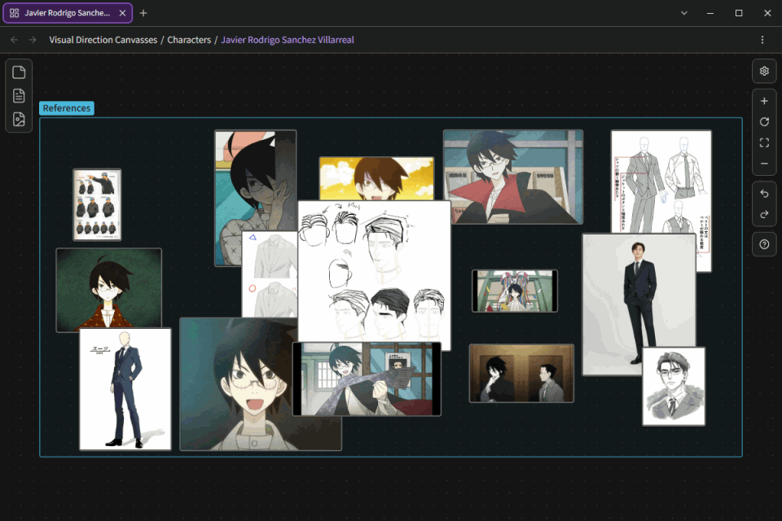
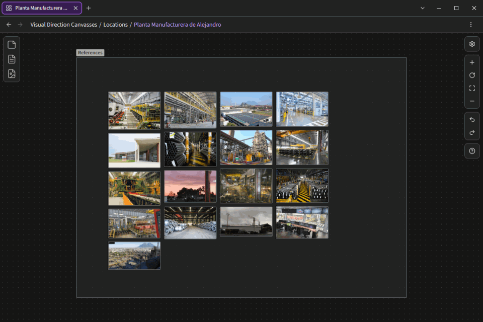

# Canvas Art Ref

Arrange, align and resize reference images on Obsidian's native Canvas, the way [PureRef](https://www.pureref.com/handbook/images/organize/) does. Canvases stay ordinary `.canvas` files and work without the plugin.



## Image actions

Select image cards, or a group that contains them, then right-click.

| Menu | Options |
| --- | --- |
| **Arrange images** | Optimal, By name, By path, By order, By addition, Randomly |
| **Align images** | Left, Right, Top, Bottom, Stack, Distribute horizontal, Distribute vertical |
| **Normalize images** | Height, Width, Size, Area, Scale, Scale selection… |
| **Optimize group** | Fit a group's boundary to its contents |

Every action is also in the command palette and is one undo step. Groups holding the images refit around them afterwards. Image files are never resized or cropped.


- **Optimal** packs images into the collage that shows them largest when zoomed to fit the current view, around any other cards.
- **By name**, **By path**, **By order**, **By addition** and **Randomly** lay images out in rows. Repeat a sort to reverse it.
- **By order** follows selection order: selected cards first, then each group's images top to bottom, left to right. **By addition** follows the order the plugin first saw each card.
- **Normalize** matches the **From first** image or the **Average**, chosen at the top of the submenu. **Size** matches the longest side; **Scale** matches size relative to each image's resolution.
- **Stack** piles images on their shared center. **Distribute** lines them up with the spacing set in settings.



**Optimize group** fits a group around everything fully inside it, including notes and nested groups, without moving its contents.

## Asset folders


- **Images folder**: where pasted and dropped images are saved.
- **Notes folder**: where new Markdown notes from the canvas are created, including **Create Markdown note…** in the canvas menu.

Set defaults in **Settings → Canvas Art Ref**. To override them for one canvas, right-click empty canvas space and choose **Canvas folders…**. Leave a field blank to inherit, or enter `/` for the vault root. Existing files never move.

## Good to know

- Per-canvas folders and addition order are kept in the plugin's own `data.json`, never in your canvases.
- The plugin makes no network requests.
- Canvas has no public editing API, so the plugin relies on Obsidian internals. Tested on Obsidian 1.15.1 for desktop; a future Obsidian update may need a plugin update. Not yet tested on mobile.

## Development

```sh
npm install
npm run build
npm run lint
npm test
```

Live testing, native checks and releasing are covered in [docs/development.md](docs/development.md).

## License

[MIT](LICENSE)
