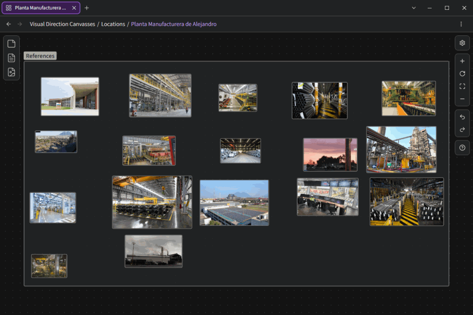
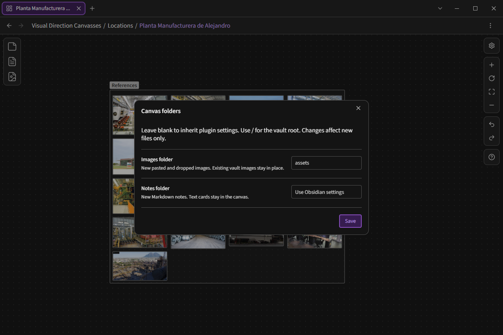

# Canvas Art Ref

Inspired by [PureRef](https://www.pureref.com/handbook/images/organize/), you can use obsidian canvases with this plugin to easily manage references.


## Image actions

Create an Obsidian group or make a selection with your cursor and right click it to get the following options:

| Menu | Options |
| --- | --- |
| **Arrange images** | Optimal, By name, By path, By order, By addition, Randomly |
| **Align images** | Left, Right, Top, Bottom, Stack, Distribute horizontal, Distribute vertical |
| **Normalize images** | Height, Width, Size, Area, Scale, Scale selection… |
| **Optimize group** | Fit a group's boundary to its contents |



- **Optimal** packs images into the collage that shows them largest when zoomed to fit the current view, around any other cards.
- **By name**, **By path**, **By order**, **By addition** and **Randomly** lay images out in rows. Repeat a sort to reverse it.
- **By order** follows selection order: selected cards first, then each group's images top to bottom, left to right. **By addition** follows the order the plugin first saw each card.
- **Normalize** matches the **From first** image or the **Average**, chosen at the top of the submenu. **Size** matches the longest side; **Scale** matches size relative to each image's resolution.
- **Stack** piles images on their shared center. **Distribute** lines them up with the spacing set in settings.


**Optimize group** fits a group around everything fully inside it, including notes and nested groups, without moving its contents.

## Asset folders



- **Images folder**: you can specify where obsidian can put your newly inserted images, be pasted or dragging from outside the vault.
- **Notes folder**: same but with note files created in the canvas.

You can set defaults in **Settings → Canvas Art Ref**. 
If you want to override them for one specific canvas, right-click empty space and choose **Canvas folders…**. Leave a field blank to inherit from defaults, or enter `/` for the vault root.

## Development

```sh
npm install
npm run build
npm run lint
npm test
```

Live testing, native checks and releasing are covered in [docs/development.md](docs/development.md).

## License

[MIT](LICENSE)
